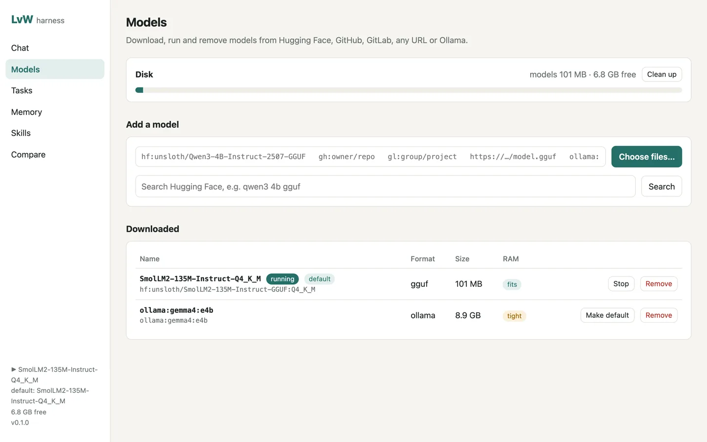
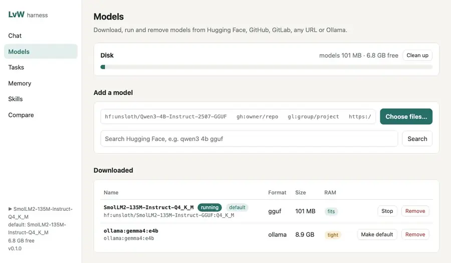
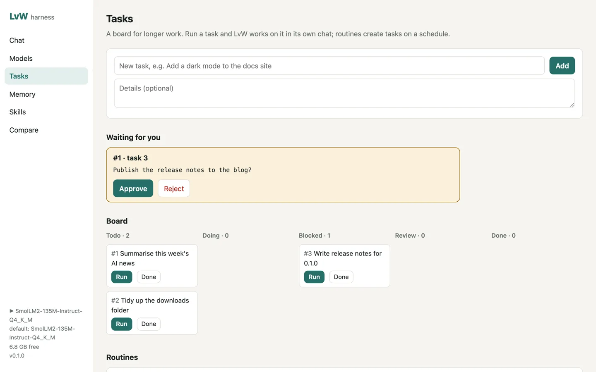
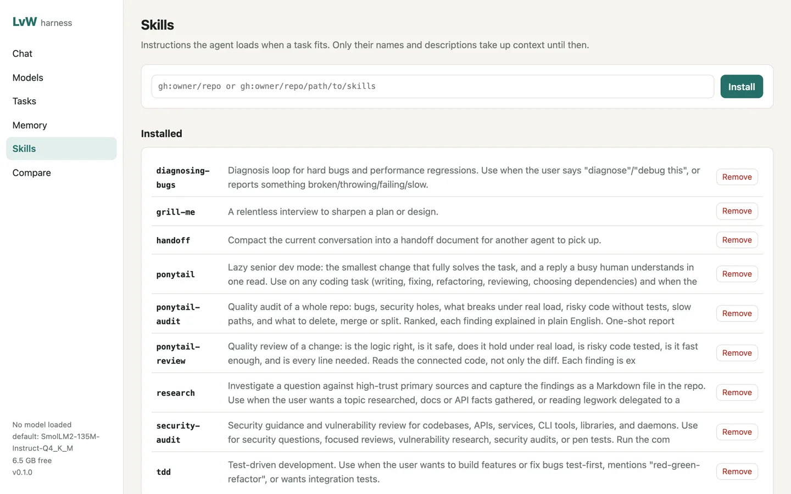

<div align="center">

# LvW-harness

**A local-first AI agent with a one-command model manager for Hugging Face, GitHub and GitLab.**

[Install](#install) · [Models](#models) · [Media](#media) · [Agent](#agent) · [Web UI](#web-ui) · [VPS](#vps) · [Commands](#all-commands) · [Credits](NOTICE.md)




</div>

LvW runs an agent on your own computer or server. It reads and edits files, runs commands, browses the web, remembers things between sessions and follows skills. It also makes pictures, short videos, speech, music and 3D models, and it understands pictures and voice notes you send it. Models run locally through [llama.cpp](https://github.com/ggml-org/llama.cpp) or [Ollama](https://ollama.com), so nothing has to leave your machine. Cloud models work too if you add a key.

The model manager is the main feature. One command downloads a model from Hugging Face, a GitHub or GitLab release, any URL or Ollama, and one command removes it again with every file it brought.

```sh
lvw model pull hf:unsloth/Qwen3-4B-Instruct-2507-GGUF:Q4_K_M   # 2.5 GB
lvw chat
lvw model rm Qwen3-4B-Instruct-2507-Q4_K_M                       # frees the 2.5 GB
```

<!-- live-links -->
**Project page:** [gitguy268.github.io/LvW-harness](https://gitguy268.github.io/LvW-harness/) · [lvw-harness.vercel.app](https://lvw-harness.vercel.app)
<!-- /live-links -->

## Install with Homebrew

```sh
brew trust gitguy268/tap
brew install gitguy268/tap/lvw-harness
```

Then run `lvw setup` once, and `lvw` (or `lvw serve` for the web UI).

<!-- run-steps:start -->
## Run it locally, step by step

1. **Install [Bun](https://bun.sh) 1.4** or newer (macOS on Apple silicon, or Linux).

2. **Get the code:**

   ```sh
   git clone https://github.com/Gitguy268/LvW-harness.git
   cd LvW-harness
   ```

3. **Install it:**

   ```sh
   bun install
   bun link
   ```

4. **Set it up.** This downloads llama-server (about 30 MB) and offers a starter model:

   ```sh
   lvw setup
   lvw doctor
   ```

5. **Start it** with `lvw`, or double-click `start.command` on a Mac for the web UI at <http://localhost:7878/>.
<!-- run-steps:end -->

## Install

You need [Bun](https://bun.sh) 1.4 or newer on macOS (Apple silicon) or Linux.

```sh
git clone https://github.com/Gitguy268/LvW-harness.git
cd LvW-harness
bun install
bun link            # puts `lvw` on your PATH
lvw setup           # downloads llama-server (~30 MB), installs the bundled skills, offers a starter model
lvw doctor          # checks disk, memory, runtimes, browser and tokens
```

On a Mac you can also double-click **`start.command`**. It installs what's missing, starts the web UI and opens it in your browser.

To build a single binary that doesn't need Bun: `bun run build` (this machine) or `bun run build:all` (macOS arm64, Linux x64 and Linux arm64, in `dist/`).

## Models



| Source | Example | What it downloads |
|---|---|---|
| Hugging Face | `hf:unsloth/Qwen3-4B-Instruct-2507-GGUF:Q4_K_M` | one quant; leave out `:Q4_K_M` to choose from a list, add `--all` for the whole repo |
| GitHub release | `gh:owner/repo@v1.2:*.gguf` | release assets matching the glob (newest release without `@tag`) |
| GitLab release | `gl:group/project@v1.2:*.gguf` | the same for gitlab.com, or your own GitLab with `LVW_GITLAB_URL` |
| Any URL | `https://example.com/model.gguf` | that file |
| Ollama | `ollama:qwen3:4b` | passed through to your running Ollama |

- **Resumes** interrupted downloads and **checks sha256** where the host publishes it (Hugging Face LFS files, GitHub release assets).
- **Checks free disk first** and refuses a download that would leave less than 2 GB (`lvw config set minFreeGB 5` to change it).
- **Estimates RAM** for each GGUF and marks it *fits*, *tight* or *too big* for this machine.
- `lvw model rm` deletes the files and the registry entry and prints the space freed. `lvw model gc` cleans up unfinished downloads.
- GGUF models run through llama.cpp (`lvw model run <name>`). Other formats (safetensors, ONNX…) can be downloaded and removed but not run by LvW.

Gated or private models need a read token: `lvw login hf|gh|gl`, or `HF_TOKEN`, `GITHUB_TOKEN`, `GITLAB_TOKEN`. Tokens are stored in `~/.lvw/credentials.json` with mode 600 and are never logged.

## Media

LvW makes images, video, speech, music and 3D models, and transcribes audio, on your own machine. Each kind has a small default model you add with one command. A hosted API is used only for a kind you haven't set up locally, and only when you have added a key for it.

```sh
lvw media install image            # stable-diffusion.cpp plus Z-Image-Turbo (6 GB)
lvw make image "a red lighthouse on a cliff at sunset, oil painting"
lvw make 3d "a small toy robot"    # draws the robot first, then builds a GLB mesh
lvw make speech "Dinner is ready." --voice female-american-english
lvw transcribe meeting.wav
lvw media ls                       # what is set up, with sizes and licences
```

| Kind | Local engine | Default model | Licence |
|---|---|---|---|
| Image (text to image, picture editing) | [stable-diffusion.cpp](https://github.com/leejet/stable-diffusion.cpp) `sd-server` | Z-Image-Turbo Q3_K (6 GB). SD 1.5 (1.6 GB) is a smaller option | Apache-2.0 |
| Video (text to video, picture to video) | the same `sd-server` | Wan 2.1 T2V 1.3B (6 GB) | Apache-2.0 |
| Speech and transcription | [Ollama](https://ollama.com) 0.40.13 or later | `lfm3-audio` (1.7 GB, 18 languages). `phonon` is a tiny English voice for Apple silicon | LFM Open 1.0 |
| Pictures and voice notes in chat | Ollama or llama.cpp | any model that sees or hears, such as `lfm3-omni` | the model's own |
| 3D (picture to 3D, text to 3D) | [TripoSR](https://github.com/VAST-AI-Research/TripoSR) in a uv-made Python env | TripoSR (1.7 GB) | MIT |
| Music and sound | [ACE-Step 1.5](https://github.com/ace-step/ACE-Step-1.5) in a uv-made Python env | ACE-Step 1.5 2B turbo (about 9 GB) | MIT |

- **In chat**, the agent gets `generate_image`, `generate_video`, `speak`, `transcribe`, `generate_music` and `generate_3d` tools for every kind that is set up. The results show up inline in the web UI and arrive as files in Telegram.
- **Pictures and voice notes** can be attached, pasted, dropped or recorded in the web chat, and sent to the Telegram bot. A model that hears gets the audio itself. For any other model, the audio is transcribed first, so the voice note still reaches it as text.
- **Create page** in the web UI: pick a kind, write a prompt or add a file, watch the steps and a live preview, and keep everything in a gallery. 3D models open in a viewer you can turn.
- Results are saved in `~/.lvw/media/<date>/`, each with a `.json` beside it holding the prompt, model, seed and settings.

<details>
<summary><b>Hosted fallbacks</b></summary>

Set these only if you want a kind to work without a local engine. Keys come from `lvw login openai|replicate` or `OPENAI_API_KEY` / `REPLICATE_API_TOKEN`.

```sh
lvw login openai
lvw config set media.api.openai '{"image":"gpt-image-1","speech":"tts-1","voice":"alloy","transcribe":"whisper-1"}'
lvw config set media.api.openai.baseUrl https://your-openai-compatible-server/v1   # optional
lvw login replicate
lvw config set media.api.replicate '{"video":"owner/video-model","music":"owner/music-model","3d":"owner/3d-model"}'
```

Replicate models take different inputs; LvW sends `prompt`, `image` and `duration`. `lvw make image "…" --model api` forces the fallback. The OpenAI-compatible fallback has unit tests against a fake server; the Replicate path has none. Neither has been run with real keys.
</details>

<details>
<summary><b>Models, engines and where they run</b></summary>

`lvw media install <kind>` sets up the engine and the default model for a kind; `lvw media pull <id>` gets another catalog model; `lvw media use <kind> <id>` changes the default; `lvw media rm <id>` removes it. Add your own sd.cpp models in `~/.lvw/media-catalog.json`, which uses the same format as [src/media/catalog.json](src/media/catalog.json).

| | macOS arm64 | macOS x64 | Linux x64 | Linux arm64 | Windows x64 |
|---|---|---|---|---|---|
| Image and video | local | local | local (CPU or Vulkan) | hosted API, or build `sd-server` yourself and set `media.sdServer` | local (CPU, Vulkan or CUDA) |
| Speech and transcription | local | local | local | local | local |
| 3D and music | local (Apple GPU) | hosted API (no PyTorch wheels) | local | local | local |

Pick a GPU build of `sd-server` with `lvw media install sd --variant vulkan` (Linux) or `--variant cuda12` (Windows). Ports: `sd-server` 7880, 3D 7881, music 7882.
</details>

## Agent

```sh
lvw chat                         # terminal chat; asks before it changes anything
lvw run "add a --verbose flag to cli.ts and run the tests"
lvw research "how do llama.cpp quant types compare?"
```

| | |
|---|---|
| **Tools** | read, write, edit, grep, glob, bash; web search and fetch; a Playwright browser with its own isolated profile per chat; memory; skills; task board; subagents; MCP servers; plugins |
| **Permissions** | `ask` (default) asks before writes, commands that change things, and clicking or typing on websites. `--auto` stops asking, except for commands that look dangerous and writes outside the working folder. `--readonly` blocks all changes. `--sandbox docker` runs commands in a container without network |
| **Memory** | Markdown notes in `~/.lvw/memory` (everywhere) and `.lvw/memory` (this project), with full-text search. `AGENTS.md` or `CLAUDE.md` in the folder are read as project rules |
| **Skills** | the `SKILL.md` format. 18 skills are bundled: design work with `impeccable`, repository onboarding, code review, debugging, TDD, security audit and more. `lvw skill browse` lists the 90-odd plugins of [wshobson/agents](https://github.com/wshobson/agents), and adding one brings its skills and subagents; `lvw skill add gh:owner/repo` installs others. Only names and descriptions go into the prompt, and the full text loads when needed |
| **Budgets** | 40 turns and 400k tokens per run by default (`budgets` in the config, `--max-turns`) |

<details>
<summary><b>Tasks, routines and approvals</b></summary>

```sh
lvw task add "Write release notes for 0.1.0" --budget 50000
lvw task run 1                     # the agent works on it; the result goes on the task
lvw routine add news "0 8 * * 1-5" "Summarise the AI news"   # runs while `lvw serve` is running
lvw task ls                        # also lists approvals waiting for you
lvw task approve 1
```

When the agent needs a decision (publishing, spending, deleting data) it calls `request_approval`, the task is marked *blocked*, and it waits for you on the Tasks page or `lvw task approve|reject`.

</details>

<details>
<summary><b>MCP servers, plugins and the scrape tool</b></summary>

```sh
lvw mcp add files -- npx -y @modelcontextprotocol/server-filesystem ~/notes
lvw mcp add remote --url https://example.com/mcp
lvw mcp ls                         # starts each server and lists its tools
lvw tool install scrapling         # adds web_scrape for pages plain fetching can't read (uses uv)
```

A plugin is a folder in `~/.lvw/plugins/<name>/` with a `plugin.json` (`{"name": "...", "description": "..."}`) and an `index.ts` that exports `tools(ctx)` returning extra tools. A `skills/` folder inside the plugin adds skills. `lvw plugin ls` shows what loaded.

</details>

<details>
<summary><b>Using a cloud model or your own browser</b></summary>

`--model` takes a downloaded model's name, `ollama:<name>`, or `<provider>:<model-id>` for any provider pi-ai supports, with its usual API key in the environment (for example `ANTHROPIC_API_KEY` or `OPENAI_API_KEY`). `lvw model use <name>` sets the default.

To let the browser tools use your logged-in browser, start it with `--remote-debugging-port=9222` and run `lvw config set browser.cdpUrl http://127.0.0.1:9222`. The agent then opens its own tabs in that browser.

</details>

## Web UI

```sh
lvw serve                          # http://127.0.0.1:7878
```

The web UI has pages for Chat (with approval cards, attachments, voice notes and a preview of HTML or SVG the agent writes), Create (images, video, speech, music and 3D), Models, Tasks, Memory, Skills and Compare (one prompt sent to several models side by side). It loads nothing from the internet and works offline.

<table>
<tr>
<td></td>
<td></td>
</tr>
</table>

## VPS

The server only listens on `127.0.0.1` unless you tell it otherwise. Any other address needs a login token: set `LVW_TOKEN`, or LvW generates one and prints it.

**Docker** (the image includes llama-server and headless Chromium):

```sh
echo "LVW_TOKEN=$(openssl rand -base64 24)" > .env
docker compose up -d               # web UI on 127.0.0.1:7878; models in the lvw-data volume, the agent's files in lvw-work
docker compose exec lvw lvw model pull hf:unsloth/Qwen3-4B-Instruct-2507-GGUF:Q4_K_M
```

Keep the port local and put HTTPS in front of it (see "HTTPS with Caddy" below). The login cookie is marked `Secure` here, so logging in over plain `http://<server-ip>:7878` won't stick, and it would send your token unencrypted. Only set `LVW_BIND=0.0.0.0` in `.env` when an HTTPS proxy on another machine needs to reach the port. Build without the browser with `docker compose build --build-arg WITH_BROWSER=0`.

**Bare Linux server** (x64 or arm64, with systemd):

```sh
bun run build:all                                  # on your machine
scp dist/lvw-linux-x64 install.sh deploy/lvw.service you@server:
ssh you@server 'mkdir -p deploy && mv lvw.service deploy/ && sudo LVW_BINARY=./lvw-linux-x64 sh install.sh'
```

The server needs glibc 2.38 or newer (Ubuntu 24.04, Debian 13 or later) to run current llama.cpp builds. `install.sh` creates an `lvw` user, data in `/var/lib/lvw`, a token in `/etc/lvw.env`, installs llama-server and starts the `lvw` service on `127.0.0.1:7878`. Once releases are published it can download the binary itself (`curl -fsSL …/install.sh | sudo sh`).

<details>
<summary><b>HTTPS with Caddy</b></summary>

```
lvw.example.com {
    reverse_proxy 127.0.0.1:7878
}
```

Caddy gets the certificate itself. Open `https://lvw.example.com` and log in with the token.

</details>

## Experimental

- **`lvw telegram`** runs a Telegram bot, so you can talk to LvW from your phone. Create a bot with @BotFather, run `lvw login telegram`, then message the bot: it replies with the command that allows your chat. Approvals show up as Yes / Always / No buttons. Photos and voice notes work too, and the pictures, sounds and clips the agent makes come back as files. The bot polls Telegram, so it needs no public address.
- **`lvw improve "<task>" --name p`** runs the same task with four prompt strategies (baseline, plan-first, verify, lean), each in a scratch copy of the folder, has the model grade every result, and saves the winner as a profile you use with `lvw run --profile p`. The grades are only as good as the model giving them.

## All commands

```text
Models
  lvw model search|info|pull|ls|rm|du|gc|run|stop|use   download, run and remove models
  lvw runtime [install|update|rm]                         llama.cpp runtime
  lvw login|logout hf|gh|gl|telegram|openai|replicate   tokens for gated models, the Telegram bot and media APIs

Media
  lvw media ls|install|pull|rm|use|out|stop              image, video, speech, 3D and music engines
  lvw make image|video|speech|music|3d "<prompt>"         make something (--image file for edits, picture to video, picture to 3D)
  lvw transcribe <audio-file>                           speech to text

Agent
  lvw chat [--model m] [--auto|--readonly] [--sandbox docker]   terminal chat
  lvw run "<task>" [--yes] [--json]                     one task, no questions
  lvw research "<question>"                             deep research report
  lvw serve [--host h] [--port p]                       web UI and API (default 127.0.0.1:7878)
  lvw telegram                                          talk to LvW from Telegram
  lvw improve "<task>" [--name p]                       experimental: tune a prompt profile (--profile p)

Extras
  lvw repo init                      add AGENTS.md and a repo map, keeping what exists
  lvw skill ls|add|browse|rm|show|approve   lvw memory ls|search|add|rm
  lvw task ls|add|show|run|done      lvw task approve|reject <id>
  lvw routine ls|add|rm|on|off
  lvw mcp ls|add|rm                  lvw tool install|rm scrapling
  lvw plugin ls

Setup
  lvw setup [--yes]   lvw doctor   lvw config [get|set|path]   lvw version
```

Data lives in `~/.lvw` (set `LVW_HOME` to move it). Ports: web UI 7878, llama-server 7879, sd-server 7880, 3D 7881, music 7882.

## Limits

- Small local models (around 4B) handle short tasks well but get unreliable over long chains of tool calls. Hard coding work goes better with a bigger model or a cloud key.
- Only GGUF models run locally through llama.cpp. Other formats are stored, not run.
- Image and video generation is slow without a GPU: a 512×512 SD 1.5 picture takes about 4 minutes on a Mac's CPU. The stable-diffusion.cpp build LvW pins renders SD 1.x models blank on Apple GPUs, so SD 1.5 runs on the CPU there. Z-Image-Turbo, the default, works on Apple GPUs: about 3 minutes for a first 512×512 picture, model loading included.
- Tested for real on a Mac (Apple silicon): Z-Image-Turbo and SD 1.5 images, speech, transcription, voice notes in chat, picture to 3D and text to 3D. Never run for real: Wan video, ACE-Step music, Linux and Windows, and the hosted fallbacks with real keys. Video only has a unit test of its request; music and Replicate have no tests.
- 3D works on one object on a plain background. Landscapes and busy scenes give an error.
- Transcription without ffmpeg reads WAV files only.
- `--sandbox docker` covers shell commands only. File tools still work directly in the folder you started in.

## Contributing and licence

See [CONTRIBUTING.md](CONTRIBUTING.md), the [Code of Conduct](CODE_OF_CONDUCT.md) and [SECURITY.md](SECURITY.md) for reporting vulnerabilities.

MIT © Lucas Van De Weerd. Bundled skills keep their own MIT licences, and models you download keep theirs. LvW reuses ideas from many projects, each credited in [NOTICE.md](NOTICE.md). It isn't affiliated with Hugging Face, GitHub, GitLab, Telegram or Ollama.
